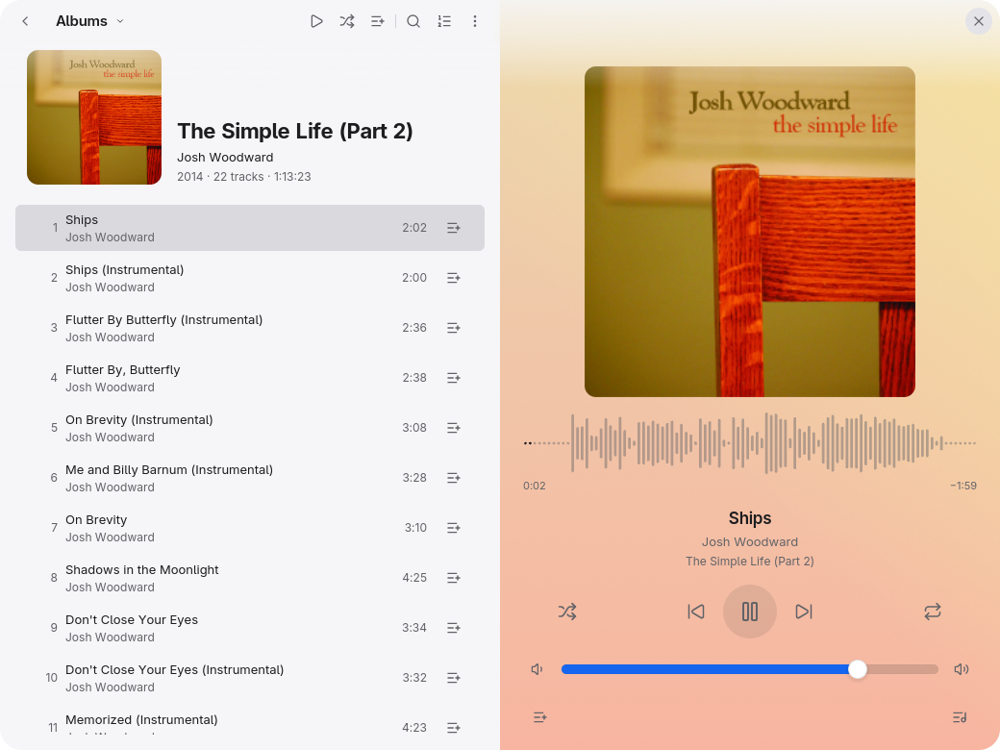
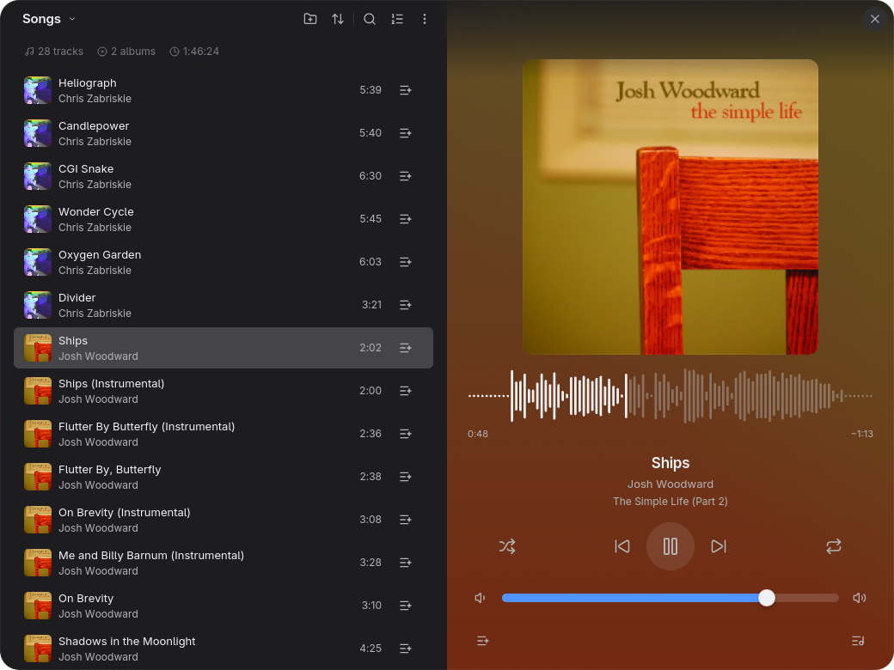
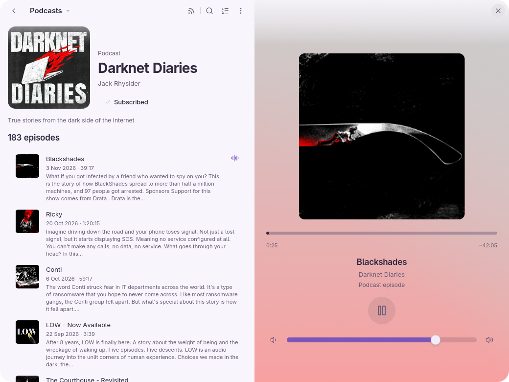
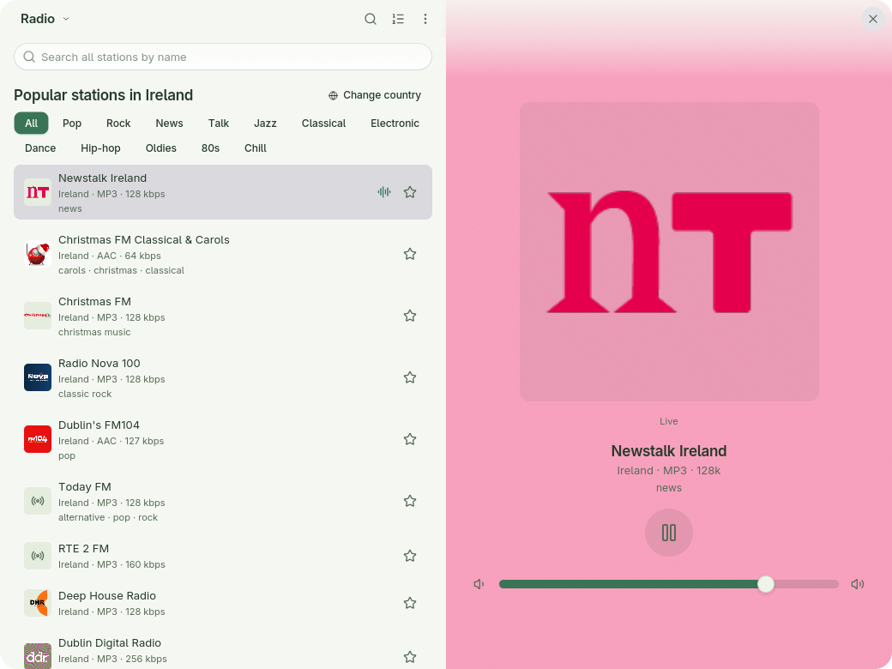
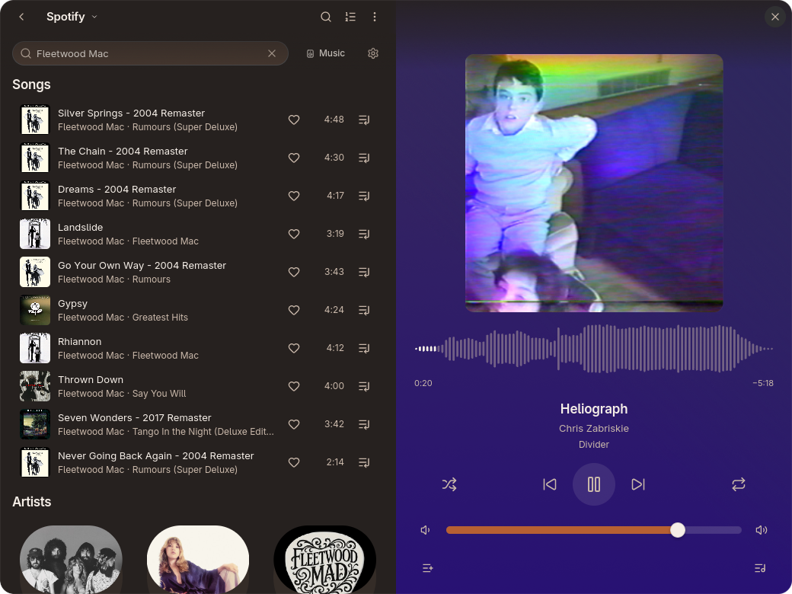
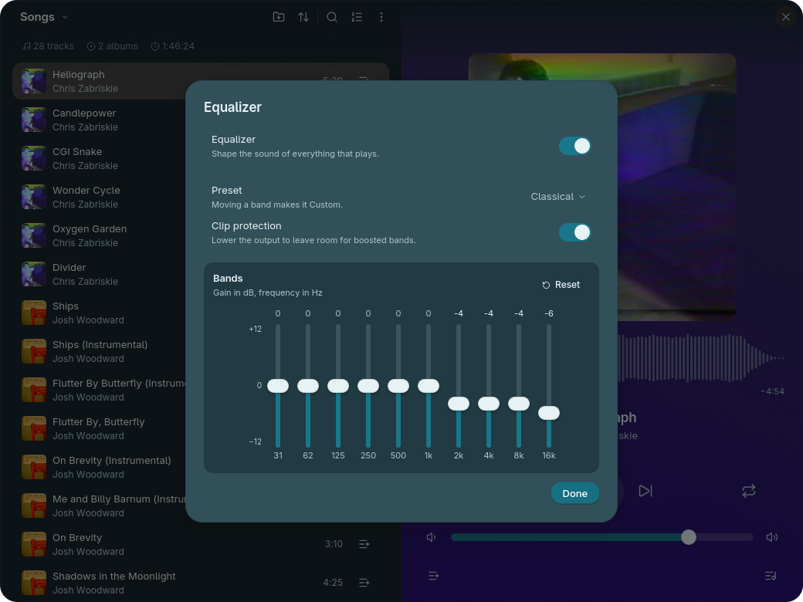
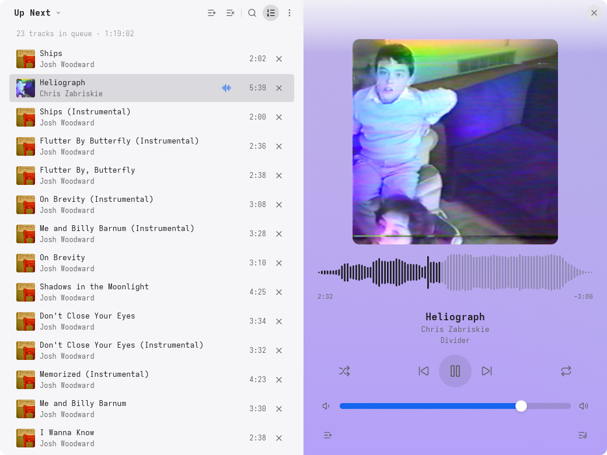
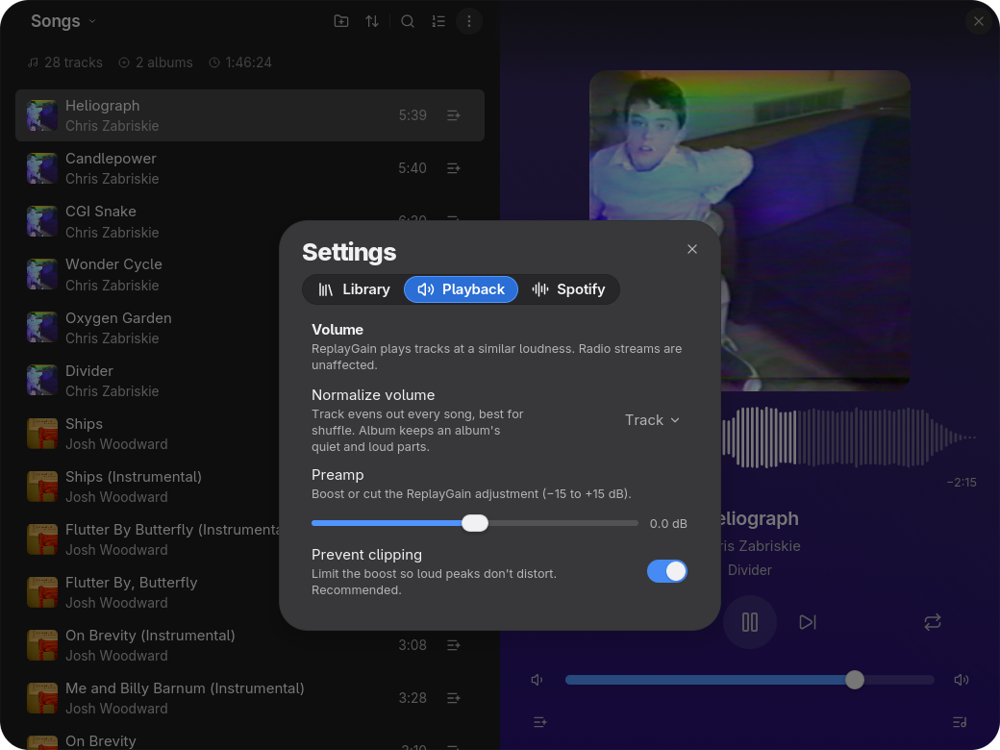

# Music

Play local music, podcasts, internet radio, and Spotify. Built with [enzUI](https://github.com/enz1m/enzui).

<table>
  <tr>
    <td align="center"><a href="docs/screenshots/basic-light.png"></a><br><sub>Album playback · light</sub></td>
    <td align="center"><a href="docs/screenshots/basic-dark.png"></a><br><sub>Local music · dark</sub></td>
    <td align="center"><a href="docs/screenshots/lavender.png"></a><br><sub>Podcasts</sub></td>
    <td align="center"><a href="docs/screenshots/sage.png"></a><br><sub>Radio</sub></td>
  </tr>
  <tr>
    <td align="center"><a href="docs/screenshots/ember.png"></a><br><sub>Spotify</sub></td>
    <td align="center"><a href="docs/screenshots/lagoon.png"></a><br><sub>Equalizer</sub></td>
    <td align="center"><a href="docs/screenshots/precision.png"></a><br><sub>Queue</sub></td>
    <td align="center"><a href="docs/screenshots/comfort.png"></a><br><sub>Playback settings</sub></td>
  </tr>
</table>

Click an image to enlarge.

## Features

- Browse albums, artists and tracks; search, make playlists, and reorder the queue.
- Subscribe to podcasts, resume episodes, and import or export OPML subscriptions.
- Discover internet radio by country or genre and save favorite stations.
- Browse Spotify, control Connect devices, and optionally use Spotify’s official Soloist player on this computer.
- Desktop media controls, equalizer, ReplayGain, waveform seeking, and listening history.

## Build and run

Use Rust **1.99.1** (minimum **1.95**), a C/C++ toolchain, and pkg-config.
Install Wayland/XKB, GLib/GIO, fontconfig, Vulkan/EGL, OpenSSL, and GStreamer
development packages plus playback plugins for your audio formats.

```sh
git clone https://github.com/enz1m/music.git
cd music
cargo build --locked
cargo run --locked
```

Dependencies pin a public enzUI revision after [Alpha 0.3](https://github.com/enz1m/enzui/releases/tag/v0.3.0-alpha.1)
and its matching public foundation forks.
No sibling framework checkout is needed.
Wayland is enabled by default; use `--features x11` for X11.
Use `cargo build --release --locked` for an optimized binary.

## Files and desktop integration

Open MP3, FLAC, M4A, Ogg/Opus, WAV, AAC, and WMA audio through Linux “Open With”
or command-line paths. Local files play from their original paths. Dropped
attachments are imported as owned files. Available codecs depend on the installed
GStreamer plugins.

## Spotify

Connect a Spotify developer application from Music’s Spotify page. Register
`http://127.0.0.1:8932/spotify/callback` as its redirect URI.
The callback listener binds this loopback port only during sign-in.

Playback uses available Spotify Connect devices. Optional playback on this
computer downloads the official Soloist build directly from Spotify on request;
it requires a Soloist API key and remains subject to Spotify’s account and
application requirements. Music does not bundle the proprietary player.
Saved credentials use the desktop keyring.

## Development

```sh
cargo fmt --all -- --check
ICED_TEST_BACKEND=software cargo test --locked -- --test-threads=1
cargo clippy --locked --all-targets --all-features -- -D warnings
```

See [contributing](CONTRIBUTING.md). Application labels are currently in English;
shared enzUI theme settings apply live. Playback restores paused.

## Screenshot credits

The local library uses Chris Zabriskie’s [Divider](https://chriszabriskie.com/divider/)
([CC BY 4.0](https://chriszabriskie.com/use/)) and Josh Woodward’s
[The Simple Life](https://freemusicarchive.org/music/Josh_Woodward/The_Simple_Life_Part_2/)
(Creative Commons Attribution). Music and artwork remain the work of their
respective creators. Podcast artwork is from [Darknet Diaries](https://darknetdiaries.com/).
Audio downloads and private review data are not included in this repository.

Licensed under [MIT](LICENSE).
